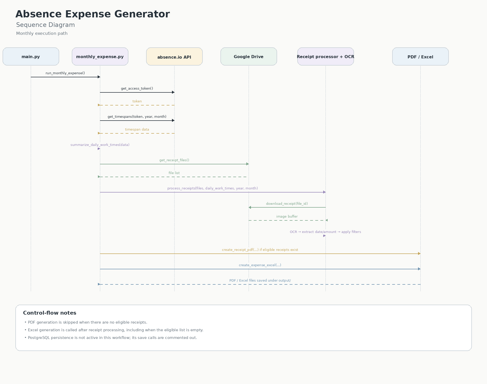

# Absence Expense Generator

[English](README.md) | [한국어](README.ko.md)

Python 기반 월별 식대 청구 자동화 프로젝트

## 1. 프로젝트 개요

Absence Expense Generator는 absence.io의 근무 기록과 Google Drive에 보관된 영수증을 연동해 월별 식대 청구 자료를 생성하는 Python 애플리케이션입니다.

근무 기록 조회, 영수증 다운로드, OCR을 통한 날짜·금액 추출, 근무일과 영수증 날짜 대조, 청구 기준 검증, 보고서 생성을 하나의 배치 흐름으로 통합했습니다. GitHub Actions에서 실행할 수 있도록 자동화 워크플로도 구성했습니다.

**현재 상태:** 2026년 9월 데이터 처리에서 영수증 PDF 및 Excel 생성까지 확인했습니다. PostgreSQL 저장 코드는 추후 재활성화를 위해 유지하고 있으며 실행 흐름에서는 비활성화되어 있습니다.

## 2. 해결하려는 문제

월별 식대 청구에는 근무 시간 확인, 영수증 수집, 날짜 대조, 결제 금액 확인, 증빙 파일 정리 등 반복 작업이 필요합니다.

이 프로젝트는 해당 과정을 자동화해 수작업을 줄이고 정해진 규칙에 따라 청구 대상과 금액을 계산하도록 설계했습니다.

## 3. 아키텍처



## 4. 주요 처리 흐름

- **근무 기록 조회:** absence.io API를 통해 대상 월의 근무 기록을 가져옵니다.
- **영수증 수집:** Google Drive API와 OAuth 인증을 이용해 지정 폴더의 영수증 파일을 조회하고 다운로드합니다.
- **OCR 및 데이터 추출:** Tesseract OCR을 사용해 영수증의 날짜와 결제 금액을 추출합니다. OCR 언어는 영어와 독일어(`eng+deu`)를 사용하도록 구성했습니다.
- **청구 규칙 검증:** 근무 시간과 날짜를 기준으로 청구 가능 여부를 확인하고 근무 기록과 영수증을 매칭합니다.
- **비용 계산:** 유효한 영수증의 실제 결제 금액을 기준으로 청구 금액을 계산합니다.
- **보고서 생성:** 월별 Excel 청구서와 날짜별 영수증을 정리한 PDF를 생성합니다.
- **자동 실행:** GitHub Actions에서 월별 배치 실행 및 수동 실행이 가능하도록 워크플로를 구성했습니다.

## 5. 업무 규칙

- 근무 시간이 8시간 이상인 날짜를 청구 대상 후보로 처리합니다.
- 근무 기록과 영수증의 날짜가 일치해야 합니다.
- 기준을 충족하지 못하거나 매칭되지 않는 데이터는 비용 계산에서 제외합니다.
- 최종 청구 금액은 청구 대상 영수증의 실제 결제 금액을 기준으로 계산합니다.

## 6. 기술 스택

| 영역 | 기술 및 구현 |
|---|---|
| 언어 | Python |
| 외부 API | absence.io API, Google Drive API |
| 인증 | API 자격 증명, Google OAuth |
| OCR | Tesseract OCR (`eng+deu`) |
| 데이터베이스 | PostgreSQL 저장 코드 구현, 현재 비활성화 |
| 컨테이너 | Docker, Docker Compose를 이용한 데이터베이스 실행 환경 구성 |
| 테스트 | pytest |
| CI/CD 자동화 | GitHub Actions |
| 보고서 | Excel, PDF |

## 7. 구현 결과 및 검증 현황

### 확인된 실행 결과

2026년 9월 데이터의 실행 로그에서 다음 결과를 확인했습니다.

- **청구 대상 근무일:** 6일
- **계산된 식대 환급 합계:** €39.00
- **처리된 영수증:** 6건
- **생성 확인 파일:** `output/receipts_2026_09.pdf`

Excel 정산 파일도 월별 배치 처리 과정에서 생성됩니다.

## 8. 테스트 및 자동화

pytest 기반 자동 테스트를 구성했으며, 최근 테스트 실행에서 24개 테스트 통과를 확인했습니다.

GitHub Actions 워크플로를 구성해 Python 환경 설정, Tesseract 설치, 의존성 설치 및 프로그램 실행을 자동화했습니다.

최근 워크플로 실행에서는 데이터 조회와 영수증 처리, PDF 및 Excel 생성까지 완료했습니다.

## 9. 보안 및 설정

외부 서비스 인증 정보는 소스 코드에 직접 작성하지 않고 환경 변수와 GitHub Actions Secrets를 통해 전달하도록 구성했습니다.

주요 설정값은 다음과 같습니다.

- `ABSENCE_CLIENT_ID`
- `ABSENCE_CLIENT_SECRET`
- `ABSENCE_USER_ID`
- `GOOGLE_DRIVE_RECEIPT_FOLDER_ID`
- `GOOGLE_TOKEN_JSON`
- Google API 인증에 필요한 자격 증명

**보안 주의사항**

- 실제 인증 정보와 OAuth 토큰을 저장소에 커밋하지 않습니다.
- 개인 영수증과 회사 내부 정보를 공개 저장소에 포함하지 않습니다.
- 공개 저장소에서는 기밀 정보가 제거된 템플릿만 사용합니다.

## 10. 실행 방법

### 로컬 실행

1. Python 3.12 환경을 준비합니다.
2. 프로젝트 의존성을 설치합니다.
3. 필요한 API 인증 정보와 환경 변수를 설정합니다.
4. Google Drive 접근 권한 및 Tesseract OCR 설치를 확인합니다.
5. 프로젝트 루트에서 실행합니다.

의존성 설치:

```bash
pip install -r requirements.txt
```

프로그램 실행:

```bash
python main.py
```

실행 전 로컬 설정 파일, 인증 정보 및 Excel 템플릿이 준비되어 있는지 확인해야 합니다.

실제 비밀값은 README에 기록하지 않습니다.

### GitHub Actions

워크플로는 예약 실행과 `workflow_dispatch`를 통한 수동 실행을 지원하도록 구성했습니다.

월별 예약 실행은 매월 5일 UTC 08:00으로 설정되어 있으며, 독일 현지 시각으로는 서머타임에 따라 09:00 또는 10:00입니다.

## 11. 프로젝트 구조

```text
absence-expense-generator/
├── .github/
│   └── workflows/         # GitHub Actions
├── absence_io/            # absence.io API 연동
├── batch/                 # 월별 정산 처리
├── config/                # 설정 관리
├── database/              # PostgreSQL 연동
├── docs/                  # 문서 및 시퀀스 다이어그램
├── expense/               # 근무 시간 및 식대 계산
├── receipts/              # 영수증 처리, OCR, PDF 생성
├── reports/               # Excel 보고서 생성
├── templates/              # Excel 템플릿
├── tests/                 # 테스트 코드
├── utils/                 # 날짜 관련 유틸리티
├── output/                # 생성된 보고서
├── main.py                # 실행 진입점
├── requirements.txt       # Python 의존성
├── .env.example           # 환경 변수 예시
├── .gitignore
└── README.md
```

## 12. 향후 개선 사항

- 비활성화된 PostgreSQL 저장 흐름 재연결 및 통합 테스트
- OCR 인식 실패와 날짜·금액 추출 실패에 대한 오류 보고 강화
- 실행 로그와 결과 파일 보관 정책 정리
- 월별 실행 결과를 기반으로 예외 상황 테스트 추가

## 13. 저장소

[GitHub Repository](https://github.com/jisun05/absence-expense-generator)